# Report / Evidence 模块架构设计与评审稿

**状态：** 第一次架构评审草案
**评审时间：** 2026 年 9 月 29 日至 9 月 30 日
**核心决策：** 可信度采用方案 B（Hybrid Claim Verification），产品展示“证据支持度”，不把未经标定的模型分数称为真实性概率。

## 1. 背景与目标

DB-GPT 已经能够执行 SQL、运行 Python、生成图表、检索知识库、读取记忆、搜索网页并生成分析文字，但这些结果目前分散在不同执行结构中，缺少统一协议将报告内容与真实执行产物连接起来。

本模块需要回答两个不同的问题：

1. **执行溯源：** 报告中的指标、图表和结论由哪些数据源和执行产物产生？
2. **结论验证：** 被引用的证据是否真的支持这条结论？

证据图谱描述的是数据源、执行活动、产物和报告内容之间的生成及依赖关系，不是模型思维链，也不展示模型私有推理过程。

## 2. 设计原则

1. 不把报告逻辑大量硬编码进当前 ReAct Agent 主循环。
2. 在现有 Skill、Tool 和 Action 执行边界旁路采集真实产物。
3. 跨层协议放在 `dbgpt-core`，持久化和 API 放在 `dbgpt-serve`，采集适配器保留在原执行模块中。
4. SQL/Python 可以确定性验证的内容优先使用规则验证，只有规则无法判断的解释性结论才调用语义验证器。
5. 新报告采用生成时带证据的强绑定路径，同时保留自由文本事后绑定路径，兼容 DB-GPT 现有回答。
6. 使用 DB-GPT 现有关系型元数据库，不引入图数据库。
7. 每次报告运行保存为不可变快照，并通过 Schema 版本保证兼容性。
8. PDF 导出和分享复用 DB-GPT 官方能力，不重复开发 Markdown 导出。

## 3. 总体架构

```mermaid
flowchart LR
    U[用户分析请求] --> A[Regular Agent / ReAct Agent]
    A --> T[现有 Skill / Tool / Action]
    T --> X[SQL / Python / Chart / KB / Memory / Web]
    X --> C[Artifact Capture Sink]
    C --> N[Artifact Normalizer]
    N --> P[Evidence Packet Builder]

    P --> G[Evidence-aware Report Generator]
    A --> F[兼容旧逻辑的自由文本答案]
    F --> E[Claim 提取和候选证据检索]
    G --> R[Evidence Resolver]
    E --> R
    R --> V[Claim Verifier Router]
    V --> AS[Report Assembler]
    AS --> S[Report Service / DAO]
    S --> DB[(DB-GPT 元数据数据库)]
    DB --> API[Report API]
    API --> UI[原生报告与证据页面]
```



Artifact Capture 是旁路能力。采集、验证或报告保存失败时，不得改变原工具执行结果，也不得阻止原对话答案保存。

## 4. 报告与产物协议

### 4.1 五类报告块

| 报告块 | 用途 | 证据要求 |
|---|---|---|
| `MetricBlock` | 单个指标 | 必须有证据 |
| `TableBlock` | SQL/Python 表格结果 | 关联数据产物 |
| `ChartBlock` | 图表及其上游依赖 | 关联图表和计算产物 |
| `InsightBlock` | 包含事实性 Claim 的分析结论 | 必须有证据 |
| `TextBlock` | 标题、说明等非事实文本 | 可无证据 |

### 4.2 四类执行产物

- `SQLArtifact`
- `PythonArtifact`
- `ChartArtifact`
- `ReferenceArtifact`：知识库、Memory、网页和模型来源

每个执行产物保存执行定位、状态、耗时、输入产物、结果摘要或持久化 URI。小型结构化结果必须保留能够重新定位的行列；大型结果保存 URI、Schema、摘要、大小和 Hash。

## 5. Schema v3：Claim 与 Segment

Schema v1/v2 保持可读取。Claim-aware 表达通过 Schema v3 引入，避免重新解释已经保存的不可变快照。

`InsightBlock` 保留 `content` 作为纯文本兼容表示，并增加结构化 `segments` 和 `claims`：

```json
{
  "block_id": "b_01",
  "type": "insight",
  "content": "本月逾期率为8.13%，整体履约表现有所改善。",
  "segments": [
    {"type": "text", "text": "本月逾期率为"},
    {"type": "claim", "segment_id": "s_01", "claim_id": "c_01", "text": "8.13%"},
    {"type": "text", "text": "，"},
    {"type": "claim", "segment_id": "s_02", "claim_id": "c_02", "text": "整体履约表现有所改善"},
    {"type": "text", "text": "。"}
  ],
  "claims": [
    {
      "claim_id": "c_01",
      "claim_type": "metric",
      "text": "本月逾期率为8.13%",
      "normalized": {
        "metric": "overdue_rate",
        "value": 0.0813,
        "unit": "ratio",
        "period": "2026-08"
      }
    }
  ]
}
```

协议校验要求：

- 所有 Segment 拼接后的文本必须等于 `content`。
- Claim ID 和 Segment ID 在同一报告内唯一。
- ClaimSegment 必须引用已经定义的 Claim。
- `start/end` 只能在报告定稿后由系统派生，不能由 LLM 生成，也不能作为主定位方式。

`EvidenceReference.target_selector` 定位到可点击 Segment：

```json
{
  "kind": "text_segment",
  "block_id": "b_01",
  "segment_id": "s_01",
  "claim_id": "c_01",
  "quote": "8.13%"
}
```

该设计避免 Python Unicode 下标、JavaScript UTF-16 下标、Markdown 渲染转换和重复数字带来的偏移问题。

## 6. EvidencePacket

`EvidencePacket` 是应用层中间结构，不是新的数据库实体，也不是可信的模型输出。它把 Artifact 转成有界、可供生成模型引用的证据句柄：

```text
[E3]
artifact=a_sql_19
selector={kind: sql_cell, row_key: {month: 2026-08}, column: overdue_rate}
metric=overdue_rate
period=2026-08
value=0.0813
```

模型可以声明“Claim 使用 E3”，但不能创建或修改 E3。EvidenceResolver 负责把合法句柄转换回真实 `artifact_id` 和 selector。

## 7. Claim-to-Evidence 双路径绑定

### 7.1 Strong Attribution

适用于新生成报告：

```text
Artifacts -> EvidencePacket -> 带 Claim、Segment 和 evidence handle 的结构化报告
          -> EvidenceResolver -> ClaimVerifier
```

生成模型一次性输出 Claim ID、Claim 类型、归一化数值、Segment 和证据句柄，但系统必须再次验证句柄及数值，不能直接信任模型引用。

### 7.2 Fallback Attribution

用于兼容 DB-GPT 已有自由文本：

```text
Free-form Answer -> Claim Extraction -> Candidate Evidence Retrieval
                 -> EvidenceResolver -> ClaimVerifier
```

该路径不要求重构 Agent 主循环，但绑定质量可能低于 Strong Path，因此需要记录 attribution path。

## 8. 方案 B：Hybrid Claim Verification

产品术语统一为 **结论证据支持度（Evidence Grounding Score）**，不称为 LLM 自信度或真实性概率。

### 8.1 Claim 类型与验证器路由

| ClaimType | 示例 | 首选验证方式 |
|---|---|---|
| `metric` | GMV 为 120 万 | 结构化值精确匹配 |
| `comparison` | 环比增长 8.3% | 确定性重算 |
| `trend` | 连续三个月下降 | 时间序列规则 |
| `ranking` | 华东排名第一 | 排名规则 |
| `aggregation` | 平均客单价 63 元 | SQL/Python 重算 |
| `descriptive` | 高价值客户集中在华东 | 数据检查加语义支持判断 |
| `causal` | 增长主要由复购驱动 | 高标准语义验证 |
| `recommendation` | 建议加强会员运营 | 不参与 factual grounding |

数值和规则可验证的 Claim 以确定性结果为准。语义验证器不得覆盖确定性的数值不一致结果。

### 8.2 VerificationResult

每个可验证 Claim 产生带版本的验证结果：

```text
ClaimVerificationResult
  claim_id
  status: VERIFIED | PARTIALLY_SUPPORTED | UNSUPPORTED |
          CONTRADICTED | UNVERIFIABLE
  verification_method: EXACT_MATCH | RECOMPUTE | TIME_SERIES_RULE |
                       RANKING_RULE | NLI | MINICHECK | LLM_JUDGE
  support_score
  evidence_artifact_ids
  verifier_name
  verifier_version
  verified_at
  diagnostics
```

不能只在 `EvidenceReference` 中加入一个无法解释来源的 confidence 浮点数。验证方式、验证器名称、版本和使用的证据必须可审计。

### 8.3 Hard Gate 与聚合方式

对第 `i` 个 Claim：

```text
G_i = traceable_i * execution_valid_i * locator_valid_i
ClaimGrounding_i = G_i * S_i
```

- `traceable`：是否绑定真实 Artifact。
- `execution_valid`：Artifact 是否执行成功。
- `locator_valid`：Selector 是否能重新定位。
- `S_i`：证据是否支持 Claim。

确定性验证的 `S_i` 通常为 1 或 0；解释性 Claim 使用带版本的语义支持分数。

报告级指标为：

```text
GroundingScore = sum(w_i * ClaimGrounding_i) / sum(w_i)
```

第一版所有可验证 Claim 权重相同，Recommendation 等非事实内容不进入分母。数据新鲜度和来源质量独立展示，不暗中混入 GroundingScore。

未经人工标定的语义支持分数不能解释成“结论为真的概率”。未来如果要展示 Calibrated Trust Score，需要建立人工标注的 Claim-Evidence 数据集，并进行独立校准和评估。

## 9. 关系型持久化

第一阶段继续使用现有五张表：

1. `dbgpt_report`
2. `dbgpt_report_run`
3. `dbgpt_report_artifact`
4. `dbgpt_report_artifact_dependency`
5. `dbgpt_report_evidence`

Claim、Segment 和完整 VerificationResult 保存在不可变 `ReportDocument JSON` 中。`dbgpt_report_evidence` 增加 Claim 查询索引及以下字段：

- `claim_id`
- `verification_status`
- `verification_method`
- `support_score`
- `verifier_name`
- `verifier_version`

只有当后续需要跨报告 Claim 统计、批量重新验证或离线 Calibration 时，再考虑增加 `dbgpt_report_claim`。第一阶段不为形式完整提前增加第六张表。

`ReportRun` 继续作为不可变版本单元，不增加语义重复的 Version 表。

## 10. 前端交互

前端按照 Segment 渲染内容。ClaimSegment 渲染成 `EvidenceAnchor`，普通 Segment 渲染成普通文字。

点击数值 Claim 时展示：

- Claim 的归一化值；
- 数据源和 Artifact；
- SQL/Python 代码及执行状态；
- 行键和列名；
- 确定性验证结果；
- 生成时间、Hash 和新鲜度。

点击解释性 Claim 时，额外展示语义支持状态、验证器及支持片段。

页面优先展示证据覆盖率、执行有效性、定位有效性、支持状态和新鲜度，再展示聚合 GroundingScore。不能使用“真实性 96%”等未经标定的表达。

PDF 导出复用官方能力。编辑、完整版本历史交互和复制源码不进入第一阶段产品范围。

## 11. 当前实现与方案差距

已经实现：

- Schema v1/v2 Report/Artifact 协议；
- SQL、Python、图表、知识库、Memory 和网页 Artifact 采集；
- Task-local ArtifactSink；
- 关系型持久化、Owner 隔离、API 和不可变 ReportRun；
- Artifact 到报告块的确定性组装；
- 原生报告原型和块级证据抽屉；
- Olist SQLite 案例数据和基准查询。

根据本次方案 B 决策需要补充：

1. 增加 Schema v3 Claim、Segment 和 Verification 模型。
2. 增加 `EvidencePacketBuilder`。
3. 增加强绑定和兼容绑定两条路径。
4. 增加 `EvidenceResolver` 和 ClaimVerifier Router。
5. 先实现确定性 Verifier，再接入可插拔语义 Verifier。
6. 补齐 Claim-to-Evidence 自动绑定。当前 ReAct 报告保存链路还没有把最终结论与候选证据完整关联起来。
7. 扩展 Evidence 索引和 API 返回字段。
8. 前端支持 Segment 级点击，不再只支持 Block 级展开。
9. 移除任何模拟可信度展示，改为可解释的 Evidence Support 维度。

## 12. 调整后的 PR 边界

1. **PR1：** Report/Evidence 核心协议（已完成）。
2. **PR2：** 关系型持久化和 API（已完成）。
3. **PR3：** SQL/Python/Chart 真实产物采集（已完成）。
4. **PR4：** Knowledge/Memory/Web 证据采集（已完成）。
5. **PR5a：** Schema v3 Claim、Segment、EvidencePacket 和序列化测试。
6. **PR5b：** EvidenceResolver 和确定性 ClaimVerifier。
7. **PR5c：** 可插拔语义验证器和 Hybrid Grounding 聚合。
8. **PR5d：** Segment 级原生前端和官方 PDF 复用。
9. **后续 PR：** Refresh/Replay、完整版本交互和人工 Calibration。
10. **案例与文档：** Olist 完整业务案例、架构说明、API 示例和兼容说明。

## 13. 第一阶段验收标准

- 每个事实性 `InsightBlock` 都包含结构化 Claim 和 Segment。
- 每个可点击 Segment 都能定位到一个真实 Claim。
- 每个 Evidence Selector 都能定位到执行成功的 Artifact。
- 数值不一致能够被确定性拒绝。
- Comparison、Trend、Ranking 和 Aggregation 能够通过规则重算。
- 只有确定性验证不能判断时才调用语义验证器。
- 每个 VerificationResult 都保存验证方法和版本。
- 非事实性 Recommendation 不进入报告 GroundingScore。
- 前端不把未校准分数称为事实真实性概率。
- 现有 Schema v1/v2 报告继续可读取。

## 14. 研究依据

本设计参考 Claim-level factuality、citation attribution、RAG grounding 和 provenance 相关工作。FActScore 支持将长文本拆分为原子事实，ALCE 区分引用正确性与完整性，RAGChecker 和 MiniCheck 支持细粒度证据支持验证，W3C PROV 则用于区分来源追踪和事实支持。

- FActScore：<https://arxiv.org/abs/2305.14251>
- ALCE：<https://arxiv.org/abs/2305.14627>
- RAGChecker：<https://arxiv.org/abs/2408.08067>
- MiniCheck：<https://arxiv.org/abs/2404.10774>
- W3C PROV Primer：<https://www.w3.org/TR/prov-primer/>
