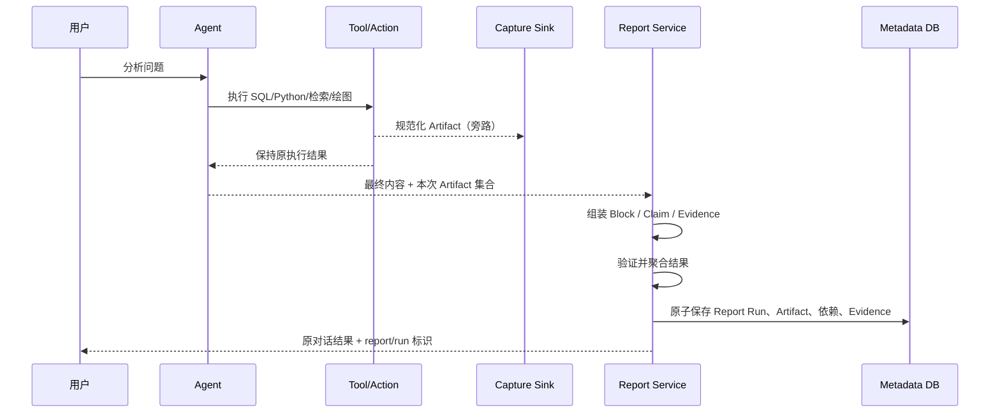
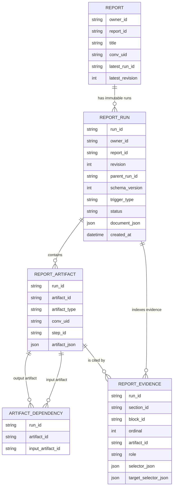

# DB-GPT 分析报告与证据图谱模块：全面架构设计

**文档状态：** 架构评审稿  
**评审目标：** 确认第一阶段模块形态、职责边界、持久化模型与演进路线  
**评审依据：** 2026-08-23 导师沟通纪要、DB-GPT 当前代码结构与已完成的分阶段协议实现  
**产品定位：** 面向数据分析报告的“可追溯、可验证、可交互”的报告能力，不是 Agent 推理过程展示功能。

## 1. 一页结论

本模块为 DB-GPT 的一次实际分析执行生成一个**不可变的 Report Run 快照**。快照保存数据源、SQL/Python/图表等执行产物、产物依赖、报告块、文字内的 Claim，以及 Claim 与证据的定位关系。页面由该快照渲染为“分析报告”和“证据图谱”两个视图。

它的核心不是保存一段最终答案，而是把下列链路完整连接：

```text
用户问题
  -> Agent 使用既有 Skill / Tool / Action 执行
  -> SQL、Python、图表、知识库、Memory、网页等真实 Artifact
  -> Artifact 依赖与 EvidencePacket
  -> ReportDocument（指标、表格、图表、结论）
  -> Claim 级 EvidenceResolver 与 VerificationResult
  -> 原生报告、证据详情与执行图谱
```

第一阶段坚持四项原则：

1. **真实产物优先。** 所有展示的证据均回链到实际执行产物，而不是模型补写的“引用”。
2. **文本片段优先。** 段落内的每个数值、趋势或结论都以稳定 Segment/Claim 定位，可分别点击。
3. **确定性验证优先。** 数值、计算和趋势先回到原始结果和规则；语义模型只是兜底。
4. **插件边界优先。** 不把业务逻辑堆进 ReAct Agent 主循环；采集、组装、验证和渲染均通过可替换组件接入。

## 2. 导师关注点与设计回应

下表将沟通纪要中的产品与架构关切转化为可验收设计，不将会议记录本身视作技术实现指令。

| 导师关注的问题 | 架构回应 | 第一阶段验收方式 |
| --- | --- | --- |
| 每个指标、图表和结论“怎么算来的” | Artifact 保存 SQL/Python、输入输出摘要、状态、耗时、Hash 和依赖；EvidenceReference 精确定位 | 任一点开均能回到执行产物与定位 selector |
| 一段文本有多个数字/指标怎么办 | `InsightBlock` 由 `TextSegment` + `ClaimSegment` 组成，独立 Claim ID | 点击同段不同数字显示各自证据 |
| 为什么只分析浦东、闵行等对象 | KB/Memory/Web 统一为 ReferenceArtifact，保存原文摘录、页码/URL/版本/抓取时间 | 来源侧栏展示实际偏好或知识片段 |
| 可信度怎么计算 | 使用 Claim-level Evidence Grounding，不展示模拟“真实性百分比” | 展示验证方式、Coverage、FGS、BCGS、矛盾数 |
| 证据图谱怎么存 | 不引入图引擎；使用关系型表保存节点快照和边，API 组装图 | 可从 Report Run 查询其 Artifact DAG 和引用边 |
| 不要污染 ReAct 核心 | Task-local capture sink 和服务层组装/验证，不修改工具返回语义 | 采集失败不影响原 Agent 回答 |
| 编辑、版本、PDF、分享的边界 | PDF/分享复用官方；编辑与完整版本交互延后；Run 快照已为后续刷新/回放预留 | 第一阶段无自研 Markdown 导出、复制源码、编辑器 |

## 3. 范围与非目标

### 3.1 第一阶段范围

- SQL、Python、图表、知识库、Memory、网页五类真实产物采集；
- 报告与证据的关系型持久化、查询 API、Owner 隔离；
- 指标、表格、图表、结论、普通文本五类报告块；
- Claim/Segment 协议、文本内多指标点击和 Evidence Drawer；
- 证据图谱（执行/产物 lineage，不包含推理过程）；
- 确定性 Claim 验证、可解释的验证状态与报告级聚合；
- Olist 巴西电商数据集的端到端案例。

### 3.2 非目标

- 不记录或可视化模型 chain-of-thought；
- 不内置图数据库或通用知识图谱引擎；
- 不重写 DB-GPT 的 Agent Loop，也不让报告模块成为一个新的 Agent；
- 不在第一阶段实现自由编辑、协作、完整版本 UI、自动刷新/回放；
- 不自行实现 PDF/分享，不增加 Markdown 导出；
- 不把未经人工校准的模型分数称为“结论为真的概率”。

## 4. 总体架构与责任边界

```mermaid
flowchart LR
    U[用户分析请求] --> A[DB-GPT Regular / ReAct Agent]
    A --> T[既有 Skill / Tool / Action]
    T --> E[SQL / Python / Chart / KB / Memory / Web]

    E -.旁路采集.-> C[Artifact Capture Sink]
    C --> N[Artifact Normalizer]
    N --> P[EvidencePacketBuilder]

    A --> F[最终回答 / 报告输入]
    P --> R[ReportAssembler]
    F --> R
    R --> D[ReportDocument]
    D --> X[EvidenceResolver]
    X --> V[VerifierRouter]
    V --> W[WeightResolver]
    W --> G[ReportAggregator]

    D --> S[Report Service / DAO]
    G --> S
    S --> M[(DB-GPT 元数据数据库)]
    M --> API[Report API]
    API --> UI[原生报告 / 证据图谱 / 官方 PDF]
```



### 4.1 `dbgpt-core`：跨层稳定协议

`dbgpt-core` 只定义可以序列化、验证和跨层使用的模型：`ReportDocument`、`Artifact`、`EvidenceReference`、`Claim`、`Segment`、`VerificationResult` 和 `EvidencePacket`。它不访问数据库、不执行 SQL、不调用模型、不渲染页面。

### 4.2 执行适配层：旁路采集

SQL、Python、图表、知识库、Memory、网页各自保留原执行路径；在其完成时向 task-local `ArtifactCaptureSink` 写入一个规范化 Artifact。采集失败只记录日志/指标，绝不能改变原 Tool 的成功或失败语义。

### 4.3 `dbgpt-serve/report`：编排、持久化与 API

报告服务负责将已捕获的产物组装为报告、持久化不可变运行快照、执行验证器、对外提供 owner-scoped API。验证器和组装器是可替换实现，不依赖当前 ReAct 范式。

### 4.4 原生前端：展示而非再计算

前端只消费报告快照、证据索引和验证结果。它不解析 SQL、不重算指标、不猜测文本偏移；所有可点击区域均由后端协议提供稳定 `segment_id` 与 `claim_id`。

## 5. 关键数据流

### 5.1 一次交互的写入链路



### 5.2 两条 Claim 绑定路径

**Strong Attribution（新报告）**：模型/模板输出 Claim、Segment 和 EvidenceHandle；系统校验 EvidenceHandle 必属当前 EvidencePacket，再解析为真实 Artifact 和 selector。

**Fallback Attribution（兼容自由文本）**：先从最终文本提取 Claim，再按“显式引用 -> 结构化 lineage -> 语义检索”的顺序找候选 Evidence。该路径必须标记 attribution path，不能与强绑定质量混淆。

## 6. 领域模型

### 6.1 Artifact：证据图谱的节点

| Artifact 类型 | 记录的关键信息 | 典型 selector |
| --- | --- | --- |
| `SQLArtifact` | SQL、数据库、列、行数、结果摘要/URI、状态、耗时 | 表结果、行键、列、单元格 |
| `PythonArtifact` | 代码、exit code、stdout/stderr、结果摘要/URI | 输出字段、表格单元格、日志范围 |
| `ChartArtifact` | 图表类型、spec、输出 URI、上游 Artifact | 图表、系列、数据点 |
| `ReferenceArtifact` | source type、来源 ID/名称、URI、locator、摘录、score | KB 文档/Chunk/页码、Memory 版本、URL/抓取时间 |

每个 Artifact 均包含 `artifact_id`、`ExecutionReference`、`input_artifact_ids`、`created_at`、`status`、`duration_ms`、错误信息与 metadata。大对象存 URI + Hash + 摘要，小型结构化结果可内联，以保证定位与复核能力。

### 6.2 ReportDocument：不可变报告快照

`ReportDocument` 是一次报告运行的自包含 JSON。它包含标题、会话、创建时间、sections、artifacts 和 metadata；每次保存生成一个不可变 `ReportRun`。历史 Run 可查询，但第一阶段不提供编辑或复杂版本比较 UI。

五类报告块：

| Block | 用途 | 证据要求 |
| --- | --- | --- |
| `MetricBlock` | 单值指标 | 必须定位到 Artifact |
| `TableBlock` | SQL/Python 结果表 | 关联数据产物 |
| `ChartBlock` | 图表与上游 lineage | 关联图表及依赖 |
| `InsightBlock` | 事实性自然语言结论 | 必须含 Evidence；Schema v3 含 Claim/Segment |
| `TextBlock` | 说明、标题、非事实文字 | 可无 Evidence |

### 6.3 文本内多指标：Segment 与 Claim

自然语言保留一份兼容的 `content`，并用 Segment 提供渲染边界。`TextSegment` 是普通文本，`ClaimSegment` 是可点击文本，后者引用唯一的 `claim_id`。所有 Segment 拼接必须等于 `content`，因而不会受到 Markdown/HTML 转换、Unicode 偏移或重复数字影响。

```json
{
  "content": "8 月逾期率为 8.13%，较上月明显改善。",
  "segments": [
    {"type": "text", "text": "8 月逾期率为 "},
    {"type": "claim", "segment_id": "s-rate", "claim_id": "c-rate", "text": "8.13%"},
    {"type": "text", "text": "，较上月"},
    {"type": "claim", "segment_id": "s-trend", "claim_id": "c-trend", "text": "明显改善"},
    {"type": "text", "text": "。"}
  ]
}
```

`EvidenceReference.target_selector` 指向 `block_id + segment_id + claim_id`，必要时带 `quote` 二次校验。前端无需也不应使用字符下标定位。

### 6.4 Claim 与 MetricDefinition

Claim 是可验证的最小命题。建议支持 metric、calculation、comparison、trend、ranking、aggregation、descriptive、causal、recommendation。数值、单位、时间范围、比较基准、维度、方向和程度等结构化语义在当前 Schema v3 的 `normalized` 承载；经过真实案例验证后再在 Schema v4 固化强类型字段。

`MetricDefinition` 是指标语义注册表，定义 `metric_key`、别名、单位、单位换算、正负方向、容差、默认比较和已批准的趋势阈值。它**不**定义业务重要性。

### 6.5 EvidencePacket

EvidencePacket 是一次报告组装期间的有界证据句柄集合。例如：

```text
[E17] artifact=a_sql_17
selector={kind: sql_cell, row_key: {month: 2026-08}, column: overdue_rate}
metric=overdue_rate; value=0.0813; unit=ratio
```

模型可引用 `E17`，但不能创建或修改它。EvidenceResolver 必须将合法句柄解析回真实 Artifact，否则引用无效。

## 7. 证据图谱与关系型持久化

### 7.1 图的语义

证据图谱展示的是可审计的执行/provenance 图：

```text
数据源 / 知识 / Memory / 网页
        -> SQL 或 Python 计算
        -> 图表 / 指标等中间产物
        -> 报告 Block / Claim
```

它不是模型如何思考、如何挑选 token 的推理轨迹。图的节点为 Artifact、Report Block、Claim；边包括 Artifact 输入依赖和 Evidence 引用。

### 7.2 存储表与职责

第一阶段以现有关系型元数据库为准，采用五张核心表：

| 表 | 粒度 | 核心用途 |
| --- | --- | --- |
| `dbgpt_report` | 逻辑报告 | owner、标题、最新 Run 与 revision |
| `dbgpt_report_run` | 不可变执行快照 | document JSON、触发类型、父 Run、状态 |
| `dbgpt_report_artifact` | Run 内 Artifact | 完整规范化 Artifact JSON 与执行定位 |
| `dbgpt_report_artifact_dependency` | Artifact 边 | 输入 Artifact 到输出 Artifact 的 DAG |
| `dbgpt_report_evidence` | Block/Claim 引用边 | 角色、source selector、target selector |

ReportDocument JSON 是权威快照；表中 Artifact、依赖、Evidence 是用于图查询、权限过滤和快速定位的索引。所有写入在单个事务内完成，防止“报告已保存但证据边缺失”。

在需要跨报告 Claim 统计、批量重新验证或校准训练集之前，不新增独立 Claim 表；届时再增加 `dbgpt_report_claim`，避免第一阶段的过度建模。

### 7.3 一致性、权限与保留

- 每个 Artifact 的 `conv_uid` 必须等于其 ReportDocument 的会话；依赖 ID 必须存在且无环；
- 仅 owner 可读取其 report/run/evidence，API 查询始终以 owner + report_id + run_id 约束；
- 结果 URI 必须保存 Hash、media type、大小与创建时间；对敏感结果只存摘要或受控 URI；
- Run 不可变。刷新/重放生成新 Run，并通过 `parent_run_id` 连接；
- 保留周期遵从 DB-GPT 部署方的数据治理配置，过期清理时需同时清理对象存储 URI 与索引行，并保留可审计的删除记录。

## 8. Claim Verification：可信度的可解释设计

### 8.1 基本立场

UI 术语使用 **结论证据支持度（Evidence Grounding）**，而非“AI 自信度”或“真实性概率”。“引用了证据”不代表“证据支持结论”；两者必须分别建模和验证。

### 8.2 验证器路由

```text
Claim + Candidate Evidence
  -> ExactMetricVerifier
  -> CalculationVerifier
  -> Comparison / Trend / Ranking / BusinessRule Verifier
  -> SemanticGroundingVerifier（必要时）
  -> LLM Judge（最后手段，明确标识）
```

| 优先级 | 验证器 | 适用范围 | 判断依据 |
| --- | --- | --- | --- |
| P0 | ExactMetric | 数值事实 | 指标、时间、维度、单位和容差一致 |
| P1 | Calculation | 派生指标 | 基于输入 Artifact 重计算 |
| P2 | Comparison/Ranking | 环比、同比、排名 | 比较对象和算子满足 |
| P2 | Trend/BusinessRule | 上升、明显改善、达标 | 指标方向与正式阈值/规则 |
| P3 | Semantic Grounding | 描述性综合结论 | MiniCheck 等可插拔后端 |
| P4 | LLM Judge | 高复杂归因 | 明示为辅助审查，不覆盖确定性矛盾 |

ExactMetric 不可只比较两个数字。`8.13%` 与 `0.0813 ratio` 可经单位换算相等；但同一个 `8.13` 若来自不同指标、月份或区域，必须拒绝绑定。

### 8.3 “明显改善”与缺规则的处理

“逾期率明显改善”只有在 MetricDefinition 或正式知识规则已定义阈值时才能被确定性验证。例如：`lower_is_better` 且下降 `>= 1.0pp`。若缺少阈值，必须返回 `INSUFFICIENT_RULE`，不能让 LLM 凭常识定义业务阈值。

### 8.4 VerificationResult

每个 Claim 保存：

```text
status: verified | partially_supported | unsupported | insufficient_evidence |
        contradicted | unverifiable | error
method: exact_match | recompute | comparison_rule | trend_rule |
        business_rule | minicheck | alignscore | llm_judge
evidence IDs, verifier name/version, reason_code, details, latency_ms
```

语义模型的 `support_score` 仅标注为 *Semantic Support Score*，并记录模型版本与阈值。复合结论的“部分支持”优先从原子子 Claim 的结果聚合，而不是按模型分数区间硬切。

### 8.5 报告级聚合与业务重要性

事实验证与业务重要性严格分离：

- `VerifierRouter`：判断证据是否支持 Claim；
- `WeightResolver`：根据用户问题和报告上下文给出 Supporting=1、Important=2、Critical=3。

页面最少展示四个结果：

```text
Evidence Coverage = 有候选证据的可验证 Claim / 全部可验证 Claim
FGS               = 原子 Claim 支持度的未加权平均
BCGS              = Σ(weight × 支持度) / Σ weight
Contradictions    = 矛盾 Claim 数与其中 Critical 数
```

Recommendation 默认 `verifiable=false`，不进入 FGS/BCGS；未来可单独研究“建议依据充分性”。

## 9. API 与前端交互

### 9.1 API 设计原则

- 所有读写均以当前用户 owner scope 约束；
- 返回不可变 run snapshot，客户端不可对其局部写回；
- 大结果使用受控 artifact URI 或分页 API，避免把完整 SQL 结果塞进初始页面；
- API 直接返回 `schema_version`、验证器版本和 capability flags，便于渐进升级。

主要能力：保存一次 Run、查询最新/指定 Run、列出 Runs、查询 Block 或 Claim 的 Evidence、查询 Artifact 依赖图、获取受控 Artifact 内容。

### 9.2 报告页

报告页呈现 Metric/Table/Chart/Insight/Text 五类 Block。图表通过现有 Artifact lineage 展开。文字使用 Segment 渲染：普通文本无交互，ClaimSegment 是可访问的按钮/链接，键盘焦点和读屏文本均提供“查看证据”。

### 9.3 Evidence Drawer

点击不同 Claim 显示独立详情：

| 触发文本 | 主要内容 |
| --- | --- |
| `8.13%` | 指标、SQL Artifact、月/列定位、原始值/展示值、Exact 结果 |
| `明显改善` | 当前/基准值、百分点差、better direction、阈值与业务规则 |
| `履约风险得到控制` | Semantic Grounding 状态、模型版本、支持片段与语义分数 |
| “关注浦东、闵行” | Memory/KB/网页原文摘录、版本/页码/URL/抓取时间 |

### 9.4 证据图谱页

图谱按“报告 Claim -> Evidence Artifact -> 上游 Artifact/Reference”展开；默认折叠长链路，支持按节点类型/失败状态筛选。关系型存储只保存图的语义，前端在读取时构造可视化布局，因此不要求服务器图计算引擎。

官方 PDF 导出和分享入口复用现有 DB-GPT 能力。若 PDF 需要包含证据详情，作为后续导出模板增强，而不是另造导出体系。

## 10. 失败处理、性能与安全

| 风险 | 处理策略 |
| --- | --- |
| Artifact 采集失败 | 不阻断原 Agent；报告标记缺失证据并保留可观测日志 |
| Tool 执行失败 | 保存失败状态、错误摘要和上游 lineage；失败 Artifact 不得作为成功证据 |
| selector 失效 | `locator_valid=false`，Claim 不得评为 verified |
| 报告写入并发冲突 | 单事务、有限重试、失败返回明确写冲突 |
| 模型引用伪造 handle | 仅解析当前 EvidencePacket 中存在的 handle |
| 敏感字段泄露 | 产物摘要/URI 访问控制、脱敏策略、owner scope、日志不打印完整敏感 payload |
| 大结果与大图 | 内联阈值控制；其余存 URI + Hash + 分页/按需加载 |
| 语义验证慢或不可用 | 异步/可选能力；返回 `unverifiable/error`，不阻塞报告基本保存 |

建议观察指标：Artifact 捕获率、报告保存成功率、selector 有效率、Evidence Coverage、确定性验证命中率、语义验证耗时、Critical contradiction 数、按数据源类型的失败率。

## 11. 与 DB-GPT 演进的兼容策略

1. Schema v1/v2 报告继续可读；Schema v3 才要求 InsightBlock 的 Claim/Segment 完整性。
2. 新增捕获和报告能力通过上下文 sink、组装器与服务适配器接入，不以 React/ReAct 分支判断作为长期架构。
3. ReportRun 是天然版本基元。后续 Scheduled Task/Replay 重新运行依赖时创建新 Run，不覆盖旧快照。
4. Strong Attribution 是默认目标；Fallback Attribution 保证旧自由文本路径可逐步接入。
5. 协议、持久化索引、API、前端按小 PR 演进，所有中间版本均可独立测试、可回滚、可审查。

## 12. 分期、当前状态与交付物

| 阶段 | 交付 | 当前状态 |
| --- | --- | --- |
| PR1 | Report/Evidence 核心协议、五类 Block、Artifact 依赖 | 已完成 |
| PR2 | Report/Run/Artifact/Evidence 持久化与 API | 已完成 |
| PR3 | SQL/Python/Chart 真实产物采集 | 已完成 |
| PR4 | Knowledge/Memory/Web 证据采集 | 已完成 |
| PR5a | Schema v3 Claim、Segment、EvidencePacket、协议测试 | 已完成 |
| PR5b | EvidenceResolver、MetricDefinition、确定性 Verifier、聚合 | 待实现 |
| PR5c | Semantic Grounding 插件与评测/校准 | 待实现 |
| PR5d | Claim 级原生交互、图谱体验、PDF 复用整合 | 待实现 |
| 后续 | Refresh/Replay、报告版本交互、人工校准 | 延后评估 |

业务验收采用 Kaggle Olist 巴西电商数据集：导入 SQLite 或上传表格，覆盖指标、图表、SQL/Python 产物、至少一个趋势规则、一个 KB/Memory/Web 来源和一个无法规则验证的描述性结论。

## 13. 架构评审需要确认的决策

1. **MetricDefinition 的治理方式：** V1 是否采用版本化 YAML/代码注册（推荐），后续再发展为管理后台或元数据库配置？
2. **业务规则权威来源：** 显著阈值只接受产品/业务方配置和正式知识文档，是否确认？
3. **Claim 生成策略：** 核心 KPI 是否优先由模板/组装器产生结构化 Claim，解释性内容才允许 LLM 输出？
4. **语义验证上线条件：** MiniCheck 等模型进入默认路径前，是否要求 Olist + 人工标注样本的 precision、召回、延迟评测？
5. **Artifact 保留策略：** 是否按部署方配置设定保留期、对象存储位置与敏感数据脱敏规则？
6. **第一阶段体验边界：** 是否确认编辑、完整版历史、自动刷新不进入首阶段，PDF/分享复用官方？

## 14. 第一阶段验收清单

- [ ] 每个事实性 InsightBlock 有结构化 Claim 与 Segment；
- [ ] 同一段文字的多个数值/结论可独立点击并定位到正确 Evidence；
- [ ] 所有 Evidence selector 都能回到执行成功的 Artifact；
- [ ] SQL/Python/Chart/KB/Memory/Web 的来源、状态和依赖可展示；
- [ ] 数值单位换算、时间/维度错配、重算错误、趋势阈值缺失均有确定性结果；
- [ ] 可信度 UI 不显示模拟分数或“真实性概率”；
- [ ] 证据图谱只展示 provenance，不泄露推理过程；
- [ ] 旧报告和原 Agent 对话链路不因采集/验证异常而失败；
- [ ] Olist 案例完整演示一次从数据源到报告、证据图谱和 Claim 验证的闭环。

## 15. 汇报用总结

本设计把“报告好不好看”升级为“报告能不能被审计”。它不让第二个大模型替第一个大模型背书，而是优先回到 DB-GPT 已执行的 SQL、Python、图表和外部引用：数值重新匹配、计算重新执行、趋势按照正式规则判断，只有无法规则化的解释性结论才走语义 grounding。

因此用户点击任何数字、图表或结论时，都可以看到它来自什么数据、经过什么执行、为何被系统选用、采用何种验证方式、是否存在证据缺失或矛盾。模块又通过稳定协议与服务层适配接入，不把实现锁死在当前 ReAct Agent 范式中，从而可以随 DB-GPT 的 Agent 架构演进而复用。

## 16. 参考方向

- FActScore：长文本拆成 atomic facts 后进行细粒度事实支持评估；
- MiniCheck：基于 grounding documents 的 Claim 支持检查，作为语义验证候选后端；
- AlignScore：通用信息 alignment，可用作语义验证对照；
- W3C PROV：来源、活动、产物的 provenance 建模参考。

---

## 附录 A：数据模型详细设计

本节回答“到底存什么、存在哪里、如何关联、如何读取”。设计采用 **不可变 JSON 快照 + 可查询关系型索引** 的双层模型：JSON 保证一次报告运行可以完整恢复；关系表保证列表、权限、证据查询和图谱查询不会扫描整份 JSON。

### A.1 实体关系与基数



关系含义：

- 一个 `Report` 是用户可见的逻辑报告，允许有多个 Run；
- 一个 `ReportRun` 是某一时刻的完整、不可修改的报告快照；
- 一个 Run 可以拥有多个 Artifact；同一物理数据源在不同 Run 中会以各自的运行快照存在，避免后续数据变化篡改历史解释；
- Artifact 之间通过依赖表构成有向无环图（DAG），例如“网页参考 -> SQL 参数 -> SQL 结果 -> Python 聚合 -> 图表”；
- 一个 Artifact 可以被多个 Block/Claim 引用；一个 Block/Claim 也可以引用多个 Artifact；因此 Evidence 是独立的多对多边，而不是 Artifact 上的单个字段。

### A.2 表一：`dbgpt_report`（逻辑报告头）

该表服务于“我的报告”列表与最新版本跳转，不保存正文或证据细节。

| 字段 | 类型/约束 | 说明 |
| --- | --- | --- |
| `owner_id` | varchar, PK 组成 | 当前 DB-GPT 用户/租户标识；所有访问的第一权限条件 |
| `report_id` | varchar, PK 组成 | 逻辑报告稳定 ID，不随刷新改变 |
| `title` | varchar | 最近一次 Run 的展示标题 |
| `conv_uid` | varchar | 产生该报告的对话标识，用于会话跳转与一致性校验 |
| `latest_run_id` | varchar, nullable | 最新不可变 Run 的 ID |
| `latest_revision` | integer | 最新 revision，乐观并发与列表展示使用 |
| `created_at` / `updated_at` | datetime | 逻辑报告的创建与最近更新时刻 |

主键为 `(owner_id, report_id)`。禁止只按 `report_id` 查询，防止跨用户猜测 ID 访问。建议索引 `(owner_id, updated_at DESC)` 用于报告列表。

### A.3 表二：`dbgpt_report_run`（不可变运行快照）

该表是系统的版本与审计基元。一条记录对应一次 interactive、refresh、replay 或 scheduled 的执行结果；`Version` 不是另一张语义重复的表，而是 `revision` + `parent_run_id`。

| 字段 | 类型/约束 | 说明 |
| --- | --- | --- |
| `run_id` | varchar, PK | 运行唯一 ID，客户端查询指定快照时使用 |
| `owner_id` / `report_id` | FK 逻辑范围 | 与 report 头保持一致，保证 owner-scoped 查询可走索引 |
| `revision` | integer, unique with owner/report | 同一逻辑报告内单调递增 |
| `parent_run_id` | varchar, nullable | refresh/replay 的父 Run；首次交互为空 |
| `schema_version` | smallint | document JSON 所遵循的协议版本 |
| `trigger_type` | enum/string | `interactive`、`refresh`、`replay`、`scheduled` |
| `status` | enum/string | 保存/生成状态；不覆盖 Artifact 自己的执行状态 |
| `document_json` | JSON/text | 经过 `ReportDocument` 校验后的权威快照 |
| `created_at` | datetime | 快照生成时间 |

唯一约束 `(owner_id, report_id, revision)`；索引 `(owner_id, report_id, created_at DESC)` 与 `parent_run_id`。新 Run 只能 INSERT，不能 UPDATE `document_json`。如需修复展示，重新生成新的 Run，而非修改历史。

### A.4 表三：`dbgpt_report_artifact`（规范化产物索引）

Artifact 表记录可追溯执行事实。完整内容仍以 `artifact_json` 保存，这样协议增加字段不需要每次迁移列；常用定位字段冗余成列，使图查询和权限检查无需解析 JSON。

| 字段 | 类型/约束 | 说明 |
| --- | --- | --- |
| `run_id` + `artifact_id` | 联合主键 | Artifact 只在所属 Run 内唯一 |
| `artifact_type` | string, index | sql/python/chart/reference |
| `conv_uid` | string, index | 必须与 Report 的 conv_uid 一致 |
| `step_id` | string | 来自 Agent/Tool 执行定位 |
| `message_id` / `task_id` / `execution_run_id` | nullable string | 连接 DB-GPT 原执行上下文，不要求每类工具都具备 |
| `artifact_json` | JSON/text | 规范化后的完整 Artifact 快照 |
| `created_at` | datetime | 建议从 Artifact 冗余，支持按时间审计 |

`artifact_json` 中的不同类型字段如下：

| 类型 | 特有字段 | 内容保留策略 |
| --- | --- | --- |
| SQL | `sql`、database、columns、row_count、result | 小结果内联 rows；大结果保存 URI/Hash/Schema/摘要 |
| Python | code、language、exit_code、stdout、stderr、result | stdout/stderr 限长、脱敏；完整输出按需存 URI |
| Chart | chart_type、spec、output | 保存图表 spec、图片/HTML URI、上游 input IDs |
| Reference | reference_type、source_id、source_name、uri、locator、excerpt、score | 保存 KB 文档/Chunk/页码、Memory 版本、URL/抓取时间/内容 Hash |

建议索引 `(run_id, artifact_type)`，并保留 `(run_id, step_id)` 以支持从执行步骤回溯产物。对 `artifact_json` 的任意 JSON path 检索不是第一阶段必需能力；跨报告检索某指标时再建立专门索引，而不是过早依赖数据库 JSON 全文扫描。

### A.5 表四：`dbgpt_report_artifact_dependency`（产物依赖边）

该表将 Artifact 的 `input_artifact_ids` 展开，面向图查询和依赖重放。字段为：

| 字段 | 说明 |
| --- | --- |
| `run_id` | 边所在的报告运行 |
| `artifact_id` | 输出/消费者 Artifact |
| `input_artifact_id` | 输入/上游 Artifact |

主键 `(run_id, artifact_id, input_artifact_id)` 防止重复边。外键语义要求两个 Artifact 均存在于同一 Run；保存前用 DFS 校验无环。查询“某图表用了哪些数据源”时，从 ChartArtifact 开始沿该表向上遍历；查询“某数据源影响哪些结论”时反向遍历，再连接 Evidence 表。

### A.6 表五：`dbgpt_report_evidence`（报告内容到证据的边）

Evidence 表表达“报告中的哪个对象，引用了产物中的哪个位置”。它不是验证结果的替代物：Evidence 说明**引用**，VerificationResult 说明**是否支持**。

| 字段 | 类型/约束 | 说明 |
| --- | --- | --- |
| `run_id` | PK 组成 | Run 作用域 |
| `section_id` / `block_id` | PK/索引组成 | 关联页面上的报告块 |
| `ordinal` | PK/索引组成 | 保留同一块的证据顺序 |
| `artifact_id` | FK 逻辑范围 | 被引用 Artifact |
| `role` | enum | `source`、`calculation`、`support` |
| `selector_json` | JSON/text | Artifact 内位置：行键、列、页码、chunk、URL 片段等 |
| `target_selector_json` | JSON/text | Block 内位置：Metric 字段、Chart 系列或 `text_segment` |

当 `target_selector.kind=text_segment` 时，要求其携带 `block_id`、`segment_id`、`claim_id`；报告协议会校验 Segment 存在、Claim 一致、quote（若有）匹配。建议索引 `(run_id, block_id, ordinal)` 支持侧栏加载，和 `(run_id, artifact_id)` 支持图谱反查。

### A.7 Claim、验证结果和索引的落点

当前阶段 Claim、Segment、VerificationResult 都是 `document_json` 的组成部分，原因是它们与 ReportDocument 一同不可变、一次读取报告时必须整体返回，且跨报告分析需求尚未证实。

当出现以下任一需求时新增 `dbgpt_report_claim` 索引表，而不是重写快照：

- 按日期/指标聚合“所有 Critical contradicted Claim”；
- 对同一历史 Claim 批量使用新版 verifier 重验；
- 建立人工标注集，校准 semantic verifier；
- 独立分页查询数万条 Claim。

预留的索引列是：`run_id`、`claim_id`、`block_id`、`segment_id`、`claim_type`、`metric_key`、`verifiable`、`verification_status`、`verification_method`、`support_score`、`importance_level`、`weight`、`verified_at`。它由快照写入时派生，不能成为第二份可编辑真相。

### A.8 事务写入顺序

保存一次报告必须使用一个数据库事务，顺序如下：

1. 冻结 `ArtifactCaptureSink`，拒绝本次任务的后续写入；
2. 将 ReportDocument 序列化为 canonical JSON，再反序列化校验 schema、ID、依赖与 selector；
3. 校验 owner、report、run、revision 和 parent_run 的权限/存在性；
4. INSERT `report_run`、所有 `artifact`、`dependency`、`evidence` 索引行；
5. 原子更新 `report.latest_run_id` 与 `latest_revision`；
6. COMMIT；任一步失败则 ROLLBACK，不留下半份图谱。

并发刷新时依赖 `(owner_id, report_id, revision)` 唯一约束进行乐观并发控制；发生冲突时有限退避重试，超过次数返回明确的写冲突，而不是静默覆盖另一份报告。

### A.9 读取模型

| 页面/接口 | 读表与返回内容 |
| --- | --- |
| 报告列表 | `report`，按 owner + updated_at 分页 |
| 最新报告 | report 找 latest_run，再读该 run 的 `document_json` |
| 指定历史 Run | `report_run`，按 owner + report_id + run_id 严格过滤 |
| Block/Claim 证据侧栏 | `report_evidence` join `report_artifact`，再按 selector 提取受控预览 |
| 图谱 | `report_artifact` + `dependency` + `evidence`，服务层组装 node/edge DTO |
| 原始大结果 | 先验证 Evidence/Artifact 所属 owner，再签发受控 URI 或分页读取 |

读取永远先验证 owner/report/run；绝不接受仅 `artifact_id` 或仅对象 URI 的直读请求。

## 附录 B：组件级架构详细设计

### B.1 Artifact Capture Sink

**职责：** 接收本次任务中真实发生的执行产物，去重、限流、规范化并在任务结束时交给报告服务。

**输入：** Tool/Action 产生的 SQL、Python、图表、检索、Memory、网页执行上下文和结果。  
**输出：** 有序 `list[Artifact]`，每个 Artifact 具备稳定 ID、执行引用、状态、耗时、输入依赖。  
**不做：** 不改变工具返回值、不执行报告生成、不解析用户文本、不持久化跨任务状态。

每个捕获适配器只处理自己知道的执行对象。例如 SQL 适配器产生列、行数、结果摘要和查询文本；KB 适配器产生 document/chunk/page locator；图表适配器保存 chart spec 并引用生成它的 SQL/Python Artifact。未知执行类型可以被忽略或以受限的 `ReferenceArtifact` 记录，不能猜测其字段。

### B.2 Artifact Normalizer

**职责：** 将不同工具格式变为 core 协议，处理 ID、时间、状态、内容内联阈值、Hash、脱敏和 URI。  
**关键规则：**

- `status=succeeded` 的 SQL/Chart 必须有结果/输出；失败、取消、超时必须有错误摘要；
- `input_artifact_ids` 只能引用本次 Capture Sink 已记录的 ID；
- 结果摘要和 selector 所指位置必须来自真实结果，不能由 LLM 填写；
- Hash 对原始字节或 canonical 内容计算；同一内容可去重存储，但 Run 内 Artifact ID 不复用为跨 Run 的事实；
- 敏感字段在写入前脱敏，原始值仍受部署方数据源权限管理。

### B.3 EvidencePacketBuilder

**职责：** 从 Artifact 中挑选可安全展示、可定位、长度受限的证据片段，给报告生成器/ClaimBuilder 使用。

**输入：** 经过 normalizer 校验的 Artifacts。  
**输出：** `EvidencePacket(handles, metadata)`；handle 至少含 `handle_id`、`artifact_id`、`selector`，可含 label/value/metric/time/dimensions。  
**限制：** 不创建数据库表、不让 LLM 改写 Artifact、不把完整敏感 SQL 结果塞进 prompt。

句柄设计的目的不是方便模型“编引用”，而是在模型输出后能由系统验证“该引用是否真存在且可定位”。

### B.4 ReportAssembler 与 ClaimBuilder

`ReportAssembler` 负责将 Artifact 确定性映射为 Metric/Table/Chart Block，并将最终回答放入 Summary/Insight Block。它不凭空生成数值。

`ClaimBuilder` 是其后续扩展：

- **模板路径：** 对单值 KPI、同比、环比、排名等，从结构化 Artifact 确定性产生 Claim；
- **结构化生成路径：** 让模型输出受 schema 约束的 Claim、Segment 和 EvidenceHandle；
- **兼容路径：** 对旧自由文本进行 Claim 提取，标记为 fallback attribution。

无论路径如何，最终都须由协议验证 `segments.join()==content`、Claim/Segment 唯一、Evidence target selector 合法。模型输出是候选，不是可信证据。

### B.5 EvidenceResolver

**职责：** 将 Claim 中的 EvidenceHandle 或候选条件解析为可验证的 Evidence 集合，并拒绝越权、失效或不相干的定位。

检索顺序：

1. 显式 handle：只接受当前 EvidencePacket 已注册的 handle；
2. 结构化匹配：按 `metric_key + time_scope + dimensions + artifact type` 过滤；
3. 语义检索：仅为 descriptive/causal 等规则无法覆盖的 Claim 取 Top-K 摘录。

Resolver 输出 `ResolvedEvidence`：Artifact、selector、规范化值、来源类型、可定位性和解析诊断。Verifier 不直接读任意 Artifact JSON，从而避免每个验证器重复实现权限/单位/selector 规则。

### B.6 VerifierRouter 与具体 Verifier

Router 根据 `claim_type`、字段完整度、ResolvedEvidence 类型、MetricDefinition 和是否存在已批准规则选择验证器。它遵从“低成本确定性优先”：一旦 Exact/Calculation 得到矛盾，语义模型不能把结果覆盖为支持。

| Verifier | 输入 | 核心计算 | 输出 detail 示例 |
| --- | --- | --- | --- |
| ExactMetric | metric Claim + 单元格 | metric/time/dimension/unit/tolerance 全匹配 | raw=0.0813、display=8.13% |
| Calculation | formula + 输入结果 | 安全的受限公式重算 | formula、operands、expected/actual |
| Comparison | 当前/基准值 | 算子与基准范围复算 | delta、ratio、operator |
| Trend | current/baseline + direction | `better_direction` 与变化符号 | previous/current/delta |
| Ranking | 候选集合 + rank | 稳定排序、并列处理 | ranking list、tie rule |
| BusinessRule | 指标规则 + Evidence | 阈值、达标规则 | threshold、matched rule ID |
| Semantic | Claim + evidence excerpts | 可插拔 MiniCheck/AlignScore | model/version/score/selected excerpts |

所有 Verifier 都返回统一 `VerificationResult`，且失败也必须带 `reason_code`。例：`MISSING_BASELINE`、`UNIT_NOT_CONVERTIBLE`、`DIMENSION_MISMATCH`、`INSUFFICIENT_RULE`、`SELECTOR_INVALID`、`MODEL_UNAVAILABLE`。

### B.7 WeightResolver 与 ReportAggregator

WeightResolver 输入用户原问题、可选分析规范、Claim 与其父子关系，输出 `ClaimImportance(level, weight, reason_code, source)`。V1 完全规则化：直接回答用户 KPI 为 Critical；其一级驱动为 Important；补充材料为 Supporting。它没有权力改变 VerificationResult。

Aggregator 的输入是所有可验证 Claim 的验证结果和 importance，输出报告级摘要及按 Block/指标/来源类型分组的统计。聚合前先剔除 recommendation 和 `verifiable=false`，并将 `contradicted` 单独计数；这避免把一个看似精确但不可解释的综合百分比当成产品结论。

### B.8 Report Service 与 API

Report Service 是唯一有权把 Capture 结果转换为持久化 Run 的服务边界。它协调 assemble、resolve、verify、aggregate、DAO save；任何子步骤失败都必须决定“降级保存（注明未验证）”或“整个报告保存失败”，但不能影响已完成的原 Agent 回答。

API DTO 应与 core wire contract 区分：核心协议保证内部兼容，API 可裁剪大字段、增加预览 URL 与 capability flags。重要 API 需要返回：`schema_version`、`attribution_path`、验证器状态、证据是否受权限限制，而非只返回 HTML 字符串。

### B.9 前端组件边界

| 前端组件 | 输入 | 职责 | 禁止事项 |
| --- | --- | --- | --- |
| `ReportRenderer` | ReportDocument | 按 Block/Segment 渲染 | 不在浏览器重算 Claim |
| `EvidenceAnchor` | ClaimSegment | 聚焦、点击、无障碍语义 | 不用字符 offset 猜定位 |
| `EvidenceDrawer` | Claim/Block evidence DTO | 展示证据、代码、定位和验证结果 | 不直接访问对象存储 |
| `LineageGraph` | graph DTO | 节点/边布局、筛选、跳转 | 不自行推导依赖边 |
| `ReportActions` | 官方能力 flags | 调用分享/PDF | 不重建导出系统 |

## 附录 C：Olist 端到端示例

以问题“本月订单履约风险是否改善，哪些地区需要关注？”为例：

1. SQL Tool 读取订单、支付、配送表，产生 `a-sql-monthly-risk`（月度逾期率）和 `a-sql-region-risk`（区域趋势）；
2. Python Tool 计算环比百分点变化，产生 `a-python-delta`，输入依赖指向前两项 SQL Artifact；
3. Chart Tool 生成区域趋势图 `a-chart-region-risk`，依赖 `a-sql-region-risk`；
4. Memory/KB 检索产生 `a-ref-focus-region`，摘录“重点关注某地区履约风险”的实际配置或文档；
5. EvidencePacketBuilder 将月度 0.0813、上月 0.0933、区域行和参考摘录生成 E17/E18/E19/E20；
6. ClaimBuilder 形成：`c1=8月逾期率8.13%`、`c2=较上月明显改善`、`c3=华南需重点关注`；
7. Resolver 将 c1 对齐 E17，c2 对齐 E17+E18+规则，c3 对齐区域结果 + ReferenceArtifact；
8. ExactMetricVerifier 验证 c1；BusinessRuleVerifier 使用“下降至少 1pp”为阈值验证 c2；若 c3 只能由解释性材料支持，交由 SemanticGroundingVerifier 或返回 insufficient evidence；
9. Service 在同一事务中保存 Run、四个 Artifact、依赖边、三条 Claim 的 evidence 边和 VerificationResult；
10. 报告页中点击 `8.13%`、`明显改善`、`华南需重点关注` 分别打开不同 Evidence Drawer；图谱页则显示从最终 Claim 回到 SQL/Python/Reference 的完整链路。
